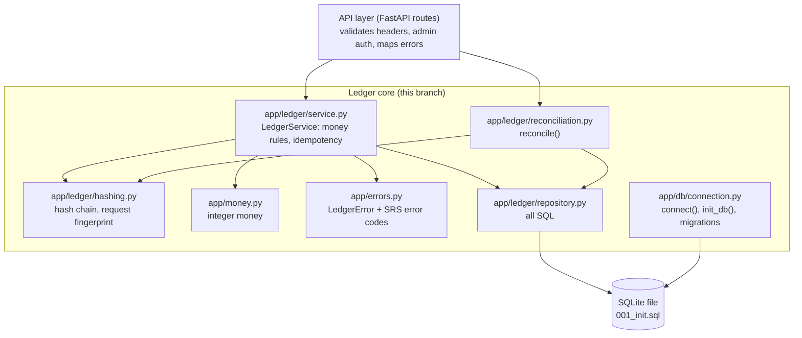
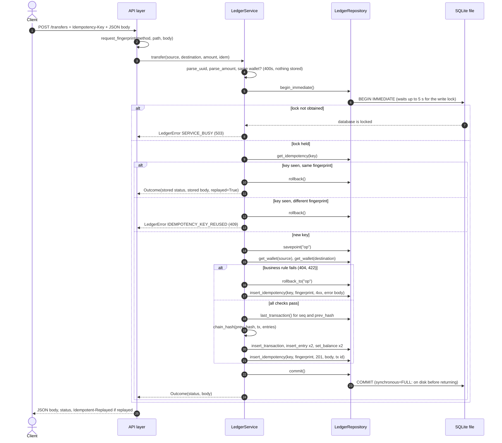
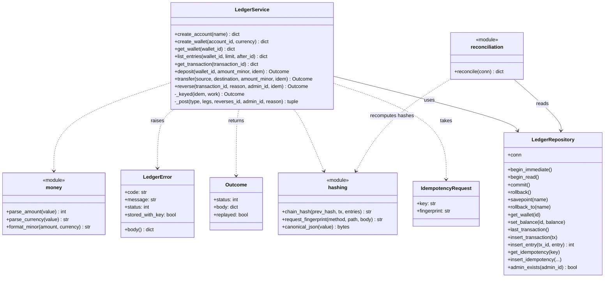

# Ledger core: design and API contract

Owner: Vishudha Sood (Ledger owner). Date: 2026-11-27. Branch: `ledger/core`.

This is what the API owner and Quality owner build on. The ledger core is the service and repository layers for FR-1 to FR-5. It has no HTTP code: the FastAPI endpoints call it.

## Components



Layer rules (NFR-16): only `repository.py` and `connection.py` contain SQL; only `service.py` and `reconciliation.py` contain money rules.

## Transfer sequence (POST /transfers)

One request, start to finish. Everything between `BEGIN IMMEDIATE` and `COMMIT` is one database transaction (FR-3.1), so it is written completely or not at all.



## Class diagram



## How to use it from FastAPI

```python
from app.db.connection import connect, init_db
from app.errors import LedgerError
from app.ledger.hashing import request_fingerprint
from app.ledger.reconciliation import reconcile
from app.ledger.service import IdempotencyRequest, LedgerService

init_db(DB_PATH)                     # once at startup (migrations + internal wallets)
conn = connect(DB_PATH)              # one connection per request (or per worker thread)
svc = LedgerService(conn)

# POST /transfers
idem = IdempotencyRequest(request.headers.get("Idempotency-Key"),
                          request_fingerprint("POST", "/transfers", body))
try:
    out = svc.transfer(body.get("source_wallet_id"), body.get("destination_wallet_id"),
                       body.get("amount_minor"), idem)
    headers = {"Idempotent-Replayed": "true"} if out.replayed else {}
    return JSONResponse(out.body, status_code=out.status, headers=headers)
except LedgerError as err:
    return JSONResponse(err.body(), status_code=err.status)
```

### Methods

| Method | Returns | SRS | Notes |
|---|---|---|---|
| `create_account(name)` | dict | FR-1.1 | 201 |
| `create_wallet(account_id, currency)` | dict | FR-1.2 | 201; 404 `ACCOUNT_NOT_FOUND`, 409 `WALLET_EXISTS` |
| `get_wallet(wallet_id)` | dict | FR-1.5, FR-1.6 | 200 |
| `list_entries(wallet_id, limit=50, after_id=None)` | dict with `entries`, `next_after_id` | FR-4.6 | limit 1–500 |
| `get_transaction(transaction_id)` | dict with `entries`, `reversed_by` | FR-4.7 | |
| `deposit(wallet_id, amount_minor, idem)` | `Outcome` | FR-1.4 | keyed |
| `transfer(source, destination, amount_minor, idem)` | `Outcome` | FR-2, FR-3 | keyed |
| `reverse(transaction_id, reason, admin_id, idem)` | `Outcome` | FR-4.2, FR-4.3 | keyed; call **after** admin auth, pass `admin_keys.id` |
| `reconcile(conn)` | report dict | FR-5 | call after admin auth; always 200 |

### Outcome vs LedgerError

| You get | Meaning | Send |
|---|---|---|
| `Outcome(status=201, replayed=False)` | Done now | `body`, 201 |
| `Outcome(replayed=True)` | Same key + same body seen before | stored status and body, plus `Idempotent-Replayed: true` |
| `Outcome(status=404/409/422)` | Business rejection, **stored** with the key (FR-2.3) | `body`, that status |
| `raise LedgerError` | Not stored: 400, 401, 409 `IDEMPOTENCY_KEY_REUSED`, 503 (FR-2.6) | `err.body()`, `err.status` |

### Things the API layer still owns
- Pass the **raw** JSON values. Do not let Pydantic coerce `"100"` or `100.0` to `100` (FR-2.7, ADR 0001): use `StrictInt` or `Any`.
- Reject unknown JSON fields (NFR-11).
- Admin authentication (NFR-9, NFR-9a): hash `X-Admin-Key` with SHA-256, look it up in `admin_keys` where `revoked_at IS NULL`, return 401 if not found, **before** calling `reverse` or `reconcile`.
- Never return stack traces (NFR-13): catch unexpected exceptions and return 500 with a generic body.

## Guarantees (tested)

| Guarantee | Test |
|---|---|
| Debits = credits; SYSTEM wallet funds deposits | `test_ledger_service.py` |
| Retry replays, different body → 409, rejections stored, 400s not stored | `test_ledger_service.py` |
| 20 simultaneous transfers on 50000: exactly 5 succeed, balance 0 | `test_concurrency_and_rollback.py` |
| Lock wait over the busy timeout → 503, nothing written | `test_concurrency_and_rollback.py` |
| Failure at any write step leaves nothing (TQ-2) | `test_concurrency_and_rollback.py` |
| History cannot be updated or deleted | `test_schema.py` |
| Reconciliation passes on normal data, fails on tampering and names the transaction (TQ-10) | `test_reconciliation.py` |
| A 201'd transfer survives a hard kill; a kill mid-transfer leaves nothing (TQ-12, NFR-6) | `test_durability.py` |
| simulate-transfer skill: pass, broken race, wrong key, no server (SK-6, SK-8) | `test_simulate_transfer_skill.py` |

## Not done here (by design)
- FastAPI routes, admin-key CLI, OpenAPI: API owner.
- CI, end-to-end HTTP tests, local-check: Quality owner.
- FR-6 FX logic: waits for BR-9. The schema already has `fx_rates`, FX clearing wallets and `transactions.fx_rate_id`.
